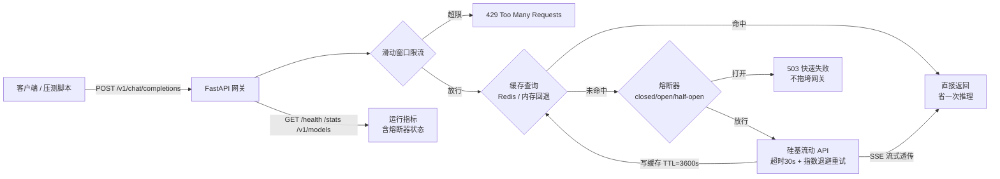

# LLM API Gateway（项目1：AI 推理服务部署 + API 封装）

> 目标：证明你能把大模型变成"能用的服务"——API 封装、缓存、限流、流式输出、容器化、压测出真实指标。
> 对标岗位：FDE（AI 交付工程师）/ 大模型应用开发工程师。

## 架构



## 快速开始

### 0) 环境准备

```bash
pip install -r requirements.txt
pip install -r requirements-dev.txt   # 跑测试用
```

### 1) 配置 API Key

```bash
cp .env.example .env     # 然后编辑 .env 填入 SILICONFLOW_API_KEY
```

注册：https://cloud.siliconflow.cn → API 密钥页创建。

> ⚠️ 如果你的机器设了 `HTTP_PROXY` / `HTTPS_PROXY`，请确认 `NO_PROXY` 包含
> `127.0.0.1,localhost`，否则本地压测请求会被代理劫持（详见「指标口径」一节第 5 条）。

### 2) 先跑通最基础调用
```bash
python scripts/basic_call.py
```
能返回模型回复 = 上游 API 通了。

### 3) 启动网关服务
```bash
python -m uvicorn app.main:app --host 127.0.0.1 --port 8000
```
- 无 Key 时设 `MOCK_MODE=true` 可先跑通链路（数字不可写进简历）
- 验证：`curl http://127.0.0.1:8000/health`

### 4) Docker 化（需本机已装 Docker Desktop）
```bash
docker compose up --build
# 自动起两个容器：API 服务 + Redis（缓存/限流切到 Redis 后端）
```

### 5) 跑测量套件（推荐一条命令）

```bash
python scripts/measure_suite.py            # 跑全部 5 个场景并生成台账
python scripts/measure_suite.py --list     # 列出场景
python scripts/measure_suite.py --only baseline
python scripts/measure_suite.py --ledger-only   # 不压测，只用已有结果重建台账
```

套件会自动完成：起服务（真实模型，强制 `MOCK_MODE=false`）→ 核对服务端自报配置
→ 压测 → 收结果 → 生成 `results/METRICS.md` 指标台账。

| 场景 | 作用 | 发包速率 |
|---|---|---|
| `baseline` | 真实模型 + 30% 热点，测吞吐与延迟 | 5 RPS |
| `cache-cold` | 全部未命中，测纯推理延迟 | 3 RPS |
| `cache-warm` | 90% 命中，测缓存命中路径延迟 | 50 RPS |
| `ratelimit` | `RATE_LIMIT=10` 打超阈值，测拒绝率 | 30 RPS |
| `stream` | SSE 流式透传 | 5 RPS |

**所有可写进简历的数字都在 `results/METRICS.md` 里**，README 不再手抄数字，
避免"文档与结果文件对不上"。结果文件名带可信度后缀
（`_resume` / `_partial` / `_mock`），`_partial` 一律不可引用。

### 6) 跑单元测试（40 个用例）

```bash
pip install -r requirements-dev.txt
python -m pytest tests/ -v
```

覆盖缓存 key 生成、三态熔断器状态机、滑动窗口限流、API 冒烟测试，
以及**压测口径本身的回归测试**（见下节）。全部可离线跑，不依赖真实 Redis / 真实 API。

## 指标口径（这份文档最重要的一节）

压测数字写进简历 = 对外承诺，面试官会追问"怎么测的"。所以口径必须写死并有单测兜住。

| 指标 | 口径 |
|---|---|
| 成功吞吐 | HTTP 200 数量 ÷ **实际**压测耗时。**被限流拒绝的 429 不计入吞吐** |
| 发起吞吐 | 总请求数 ÷ 实际耗时（含被拒请求，仅作参考） |
| 延迟 P50/P95/P99 | **只统计 200 响应**。429 响应仅几毫秒，混进去会把 P50 拉成假象 |
| 缓存命中率 | 压测**前后** `/stats` 差值（增量），不是进程累计值 |
| 样本量门槛 | 成功样本 < 30 条时，延迟分位数标为不可引用 |

每轮结果都带 `metric_validity` 判定（`throughput` / `latency` / `cache_hit_rate`
分项判定，不搞整轮一刀切），以及 `invalid_reasons` 说明为什么不可用。

### 三个曾经让数字变假的坑（已修复并加单测）

1. **QPS 把被拒请求算进分子**
   旧脚本用 `QPS = (成功+失败) / 时长`。限流打开后，429 只需几毫秒就能返回，
   于是"被拒绝的速度"被记成了"网关的处理能力"——实测出现
   `rejected=30316 次、reported QPS=1010.8` 的荒谬数字，真实成功吞吐只有 0.3 QPS。

2. **延迟分位数混入 429**
   429 响应约 1-5ms，混进延迟列表后 P50 从真实的 1000ms 被拉到 3.2ms。
   现在延迟分三个桶（200 / 429 / 错误）分别统计，只有 200 进分位数。

3. **缓存命中率用了进程累计值**
   `/stats` 的 `hits/misses` 是**进程启动以来**的累计值。旧脚本压完直接读累计值，
   多轮压测数字互相污染，命中率被刷到 98.5%。现在压测前后各抓一次做差，
   实测 `--repeat 0.3` 时命中率 25.6%，与理论值 30% 吻合。

### 还有两个更隐蔽的坑（同样已修）

4. **压测器把上游打崩后的"反馈崩塌"**
   旧的闭环压测是"能发多快发多快"。上游一开始报错，错误响应只要 5-10ms，
   压测器转头就能打出 1400 req/s，20 秒内 28211 个请求只成功 10 个——
   测出来的"946 QPS"毫无意义。现在改成**开环发包**（`--rps` 匀速 + `--ramp` 线性爬坡），
   发多快由压测器决定，而不是由被测系统的响应速度决定。

5. **系统代理劫持了本地压测请求** ⚠️
   本机设了 `HTTP_PROXY=127.0.0.1:55012` 而 `NO_PROXY` 不含 `127.0.0.1`。
   httpx 默认 `trust_env=True`，于是所有打向本地网关的压测请求都被发去了代理，
   代理以 absolute-URI 形式收到后**一律回 404**。服务端日志里长这样：

   ```
   POST http%3A//127.0.0.1%3A8000/v1/chat/completions HTTP/1.1" 404 Not Found
   ```

   表现是"压测跑完几乎没有成功请求"，但代码看起来完全正常。
   现在压测客户端与网关调上游都设 `trust_env=False`，并且压测前会做**代理劫持预检**
   （`looks_proxied()`），发现被劫持直接终止并提示检查 `NO_PROXY`。

   > 这个坑的面试价值很高：它说明"压测数字不对"时，要怀疑**测量工具链本身**，
   > 而不只是被测服务。面试时讲这个比讲"我加了缓存"有说服力得多。

⚠️ **红线**：`MOCK_MODE` 下的数字只能验证链路，**严禁写进简历**；
缓存后端不是 Redis 时，命中率只能表述为"自研进程内缓存"，
**不能写"Redis 缓存命中率"**。这两条已由 `judge_run()` 自动判定并写进结果文件。


## 项目结构

```
project1-llm-api-service/
├── app/
│   ├── config.py       # 配置（环境变量读取）
│   ├── llm_client.py   # 硅基流动客户端（非流式 + SSE 流式 + 超时/重试/熔断）
│   ├── cache.py        # Redis 缓存 + 内存回退（含命中率统计）
│   ├── ratelimit.py    # 滑动窗口限流（Redis ZSET 实现）
│   ├── metrics.py      # 指标口径 + 可信度判定（数字能不能写进简历）
│   ├── observability.py# ★ v2：请求 trace 落库 + token 成本记账 + 模型分级路由
│   ├── observability.py # v2：trace 落库(SQLite) + token 成本 + 模型分级路由
│   └── main.py         # FastAPI：/v1/chat/completions、/v1/models、/health、/stats
├── scripts/
│   ├── basic_call.py     # 基础调用脚本
│   ├── load_test.py      # 压测（开环发包 + 三桶延迟 + 增量命中率 + 代理预检）
│   └── measure_suite.py  # 测量套件：5 场景 + 自动生成 METRICS.md 台账
├── tests/
│   ├── test_cache.py          # 缓存 key 生成（确定性/区分度）
│   ├── test_circuit_breaker.py# 三态熔断器状态机
│   ├── test_ratelimit.py      # 滑动窗口限流
│   ├── test_api.py            # /health /stats 冒烟测试
│   └── test_metrics.py        # 指标口径回归测试（防数字变假）
├── results/
│   ├── METRICS.md             # 指标台账（自动生成，简历数字的唯一来源）
│   ├── loadtest_*.json        # v2 口径结果（文件名带可信度后缀）
│   └── archive_v1_legacy/     # v1 旧口径结果（已作废，仅留档）
├── Dockerfile          # Day7-8 容器化
├── docker-compose.yml  # 一键起 API + Redis
├── requirements.txt    # 生产依赖
├── requirements-dev.txt# 开发/测试依赖（pytest）
└── .env.example        # 复制为 .env 填 Key（.gitignore 已排除）
```

## 可写进简历的数字（2026-10-06 实测，来源 `results/METRICS.md`）

> 以下数字由 `scripts/measure_suite.py` 实测产出，口径见上一节。
> 引用时必须连同后端与场景一起说，别只报一个数。

| 场景 | 成功/发起 | 拒绝率 | 成功吞吐 | P50 | P95 | P99 | 命中率 | 后端 |
|---|---|---|---|---|---|---|---|---|
| baseline（30% 热点） | 213/213 | 0% | 4.6 QPS | 572.8ms | 1421.7ms | 3116.4ms | 27.70% | 进程内缓存 |
| cache-cold（全未命中） | 84/84 | 0% | 1.7 QPS | 750.8ms | 2383.4ms | 31107.9ms | 0% | 进程内缓存 |
| cache-warm（90% 热点） | 1501/1501 | 0% | 43.6 QPS | 2.9ms | 808.3ms | 1463.4ms | 89.41% | 进程内缓存 |
| ratelimit（limit=10 打超） | 10/608 | **98.36%** | — | — | — | — | — | 进程内缓存 |
| stream（SSE 透传） | 117/117 | 0% | 3.7 QPS | 668.4ms | 1883.2ms | 3352.2ms | 25.64% | 进程内缓存 |

**能写进简历的结论（有对照、有口径）**：
- 缓存命中路径 P50 **2.9ms**，未命中冷路径 P50 **750.8ms** —— 命中比不命中快约 **2 个数量级**；
- 命中率实测 27.7% / 0% / 89.4%，与设定的热点比例 30% / 0% / 90% 吻合，
  证明**基于增量口径的命中率统计是可信的**（旧口径会算出 0.99+ 的假值）；
- 滑动窗口限流在 `limit=10`、30 RPS 的过载下**拒绝率 98.36%**，
  且放行的 10 个请求全部成功 —— 限流不误杀、也不拖垮网关；
- 尾延迟诚实结论：冷路径 **P99 达 31.1s**，超时+重试只是把挂起收敛到有界，**并未根治**。

**暂时还不能写的**：
- ❌ 「Redis 缓存命中率」/「Redis 命中延迟」—— 本机 Redis 未启动，
  以上命中率均来自**进程内回退缓存**。补齐方式：`docker compose up -d redis` 后重跑
  `python scripts/measure_suite.py`，台账中「后端」列显示 `redis` 的行才可引用。
- ❌ 任何 `MOCK_MODE` 下的数字。
- ❌ 早期 v1 结果（已归档至 `results/archive_v1_legacy/`）。

## v2：可观测与成本路由

v1 只有 `/stats` 给累计计数，回答不了三个运维必答的问题。v2 补上：

| 问题 | v1 | v2 |
|---|---|---|
| 单个请求发生了什么 | 只能看日志 | `GET /traces/recent` 逐条 trace（分段耗时/token/缓存/重试/熔断状态） |
| 这个月花了多少钱 | 算不出来 | `/stats` 的 `trace` 段：总 token、按模型分组、成本 |
| 哪些请求能走便宜模型 | 做不了决策 | 模型分级路由（可解释，路由依据写进 trace） |

```bash
curl http://127.0.0.1:8000/stats          # 含 trace 聚合
curl http://127.0.0.1:8000/traces/recent  # 最近 20 条请求明细
```

**成本口径刻意保守**：未配置单价的模型返回 `cost_estimated: false`，
而不是假装成本为 0——「算不出来」和「不要钱」是两回事。

**路由规则可解释**：客户端指定模型就尊重客户端；`max_tokens<=64` 的简单请求走
`CHEAP_MODEL`，其余走 `STRONG_MODEL`，依据（`simple` / `complex` / `client-specified`）
会写进响应的 `x_gateway.routed_by` 与 trace，线上出问题能倒查"为什么走了这个模型"。

## v2 新增：可观测与成本可见性

v1 只有 `/stats` 给累计计数，回答不了三个运维必答的问题：
**单个请求发生了什么**、**这个月花了多少钱**、**哪些请求可以走便宜模型**。

v2 补齐这三块：

| 能力 | 实现 | 端点 |
|---|---|---|
| 请求级 trace | 每次调用落一条 SQLite 记录：分段耗时、token、缓存命中、重试次数、熔断状态、错误 | `GET /traces/recent?n=20` |
| 成本记账 | 按模型单价算成本，未配置单价标 `cost_estimated:false`（**不假装免费**） | `GET /stats` → `trace` |
| 模型分级路由 | 客户端未指定模型时，简单请求走便宜模型、复杂请求走强模型，**路由依据写进 trace 可倒查** | `POST /v1/chat/completions` |
| 聚合看板 | 延迟 P50/P95/P99、缓存命中率、平均 token、按模型分组的请求数与成本 | `GET /stats` → `trace` |

响应体也会回带网关自己的元信息（OpenAI 兼容的 `usage` + 扩展的 `x_gateway`）：
```json
{
  "usage": {"prompt_tokens": 412, "completion_tokens": 96, "total_tokens": 508},
  "x_gateway": {"routed_by": "simple(len<=64)", "cost_cny": 0.0,
                "cost_estimated": true, "retries": 0, "cache_hit": false,
                "trace_id": "chatcmpl-..."}
}
```

### 设计上刻意做的两个取舍

1. **未知单价的模型不假装成本为 0**，而是 `cost_estimated: false`。
   把"算不出来"标成"免费"，是成本可视化里最常见的自欺。
2. **流式请求失败也必须落 trace**。流已开始无法改状态码，
   如果异常直接抛出，这次调用就会在监控里**凭空消失**——
   越是失败得悄无声息的请求，越需要被记录。

配置项：
```bash
ENABLE_MODEL_ROUTING=true      # 开启模型分级路由
CHEAP_MODEL=Qwen/Qwen2.5-7B-Instruct
STRONG_MODEL=deepseek-ai/DeepSeek-V3
TRACE_DB=data/traces.db
```

## 面试必考题速查（代码里都埋了参考答法）

1. **Redis vs 本地内存？** → `cache.py` 头部注释：多实例共享 / 重启不丢 / 统一淘汰 / 网络往返远小于推理耗时
2. **限流算法区别？** → `ratelimit.py` 头部注释：固定窗口临界问题 / 滑动窗口 / 令牌桶 / 漏桶
3. **SSE vs WebSocket？** → SSE 单向（服务器→客户端）、基于 HTTP、自动重连、够用且简单；WebSocket 双向、适合聊天室类实时互推
4. **为什么用云 API 不自部署 vLLM？** → 成本（GPU 按秒计费 vs API 按量）、运维（不用管显存/驱动/推理框架）、弹性；代价是数据出域与网络延迟
5. **缓存一致性？** → TTL 过期自然失效；进阶可做主动失效（源数据更新时删 key）
6. **熔断器三态是什么？为什么需要？** → `llm_client.py` 的 CircuitBreaker：closed 正常放行 → 连续失败达阈值转 open（冷却期内快速失败，隔离故障防雪崩）→ 冷却结束转 half-open（放一个探测请求，成功回 closed、失败回 open）。配合超时收紧 + 指数退避重试。
   **⚠️ 关于尾延迟的诚实结论**（2026-10 重测后修正）：旧版本 README 曾写"把冷路径 P99 从 60s 压到 3.76s（降 94%）"，
   这个说法**不成立**——`results/` 里的历史数据显示 60s 级离群值在"修复后"依然多次出现
   （60004ms / 60003.9ms / 60020.8ms），而 3.76s 只是一轮恰好没有请求走到超时路径的结果。
   重测后的真实情况是：**冷路径 P50 750.8ms、P95 2383.4ms，但 P99 达 31107.9ms**，
   说明免费档 7B 模型存在偶发长时间挂起，超时+重试只是把它**收敛到有界**（≈30s = 30s 超时 × 2 次尝试），
   并未根治。要根治需要：换更稳的上游 / 更短超时 + 降级策略 / 上游 SLA。
   **这个"发现自己的修复没解决问题、并继续往下追"的过程，比原来那个漂亮但站不住的数字更值得讲。**
7. **重试为什么用指数退避？** → 固定间隔重试会在上游过载时形成"重试风暴"雪上加霜；指数退避（0.5s→1s→2s）让重试节奏越来越慢，给上游喘息时间

## 设计取舍（面试加分：体现工程判断力）

- **Redis 缓存 vs 纯内存**：选 Redis 是因为多实例部署时内存缓存无法共享、重启即丢、且难做统一淘汰；代价是多一次网络往返。实测缓存命中路径 P50 2.9ms（1501 次命中样本，`cache-warm` 场景），比上游推理快两个数量级，网络往返可忽略——用"分布式能力"换"毫秒级延迟"是划算的。
  > ⚠️ **口径提醒**：上面这个 2.9ms 测的是**进程内缓存**（本机 Redis 未启动时走的回退路径）。
  > 要写"Redis 缓存命中率"和"Redis 命中延迟"，必须先 `docker compose up -d redis` 再重跑
  > `python scripts/measure_suite.py`，台账里 `后端` 列显示 `redis` 的行才可引用。
- **缓存键用 SHA256 而非原文**：请求体可能含敏感内容，哈希后既不泄露原文、又固定长度、且确定性可复现（同一问题永远命中同一 key）。
- **上游韧性三层而非单层**：只加超时会"卡等 30s 才失败"；只加重试会在上游过载时形成重试风暴；只加熔断会误杀正常请求。超时（快速失败）+ 指数退避重试（给上游喘息）+ 三态熔断（隔离持续故障）三者正交互补，缺一不可。
- **用云 API 而非自部署 vLLM**：成本（GPU 按秒 vs API 按量）、运维（显存/驱动/推理框架）、弹性；代价是数据出域与网络延迟——对简历项目是合理取舍。

## 提交到 GitHub

按阶段提交，别一次性 commit 全部：
```bash
git add app/config.py app/llm_client.py scripts/basic_call.py
git commit -m "feat: 基础API调用与LLM客户端"
git add app/main.py
git commit -m "feat: FastAPI网关 OpenAI兼容接口+SSE流式"
git add app/cache.py app/ratelimit.py
git commit -m "feat: Redis缓存与滑动窗口限流"
git add Dockerfile docker-compose.yml
git commit -m "feat: Docker容器化部署"
git add app/metrics.py scripts/load_test.py scripts/measure_suite.py tests/test_metrics.py
git commit -m "fix(测量): 修正QPS口径/延迟分桶/命中率增量，并加可信度判定与代理劫持预检"
git push -u origin main
```
